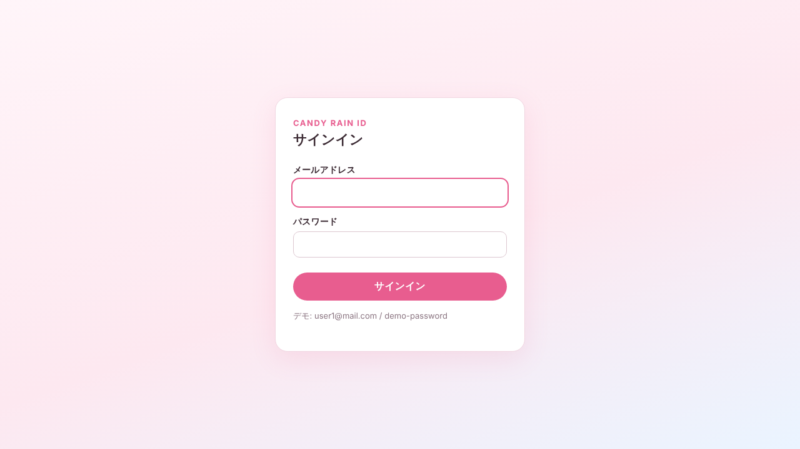

# Candy Rain ID（candy-rain-identity-server）

[Candy Rain Store](https://github.com/Sparklingstadt/candy-rain-store) 向けの認証サーバーです。Go で書いた小さな **OpenID Connect プロバイダー**で、ストアは「Candy Rain ID でサインイン」からこのサーバーを経由してログインします。



## しくみ

```text
ブラウザ ──①サインイン──▶ candy-rain-store (Auth.js)
   │                          │
   │ ②/authorize へリダイレクト（PKCE S256）
   ▼                          │
Candy Rain ID ─③メール・パスワード照合─▶ PostgreSQL "User" テーブル（ストアと共有・読み取りのみ）
   │                          │
   │ ④認可コードを付けてストアへ戻す
   ▼                          ▼
candy-rain-store ──⑤/token でコードを ID トークンに交換（client_secret_basic）
```

- **認可コードフロー + PKCE（S256 必須）**。対応する client は 1 つ（candy-rain-store）
- ユーザーはストアの PostgreSQL の `User` テーブルを **そのまま参照**し、bcrypt でパスワードを照合します。ユーザー移行は不要で、スキーマとマイグレーションの管理はストア側のままです
- ID トークンの `sub` はストアの `User.id` なので、カート・注文はそのまま引き継がれます。`role`（`CUSTOMER` / `ADMIN`）も返すため、管理画面の権限判定も変わりません
- ID サーバー自身のサインイン状態（Cookie, 8 時間）を持つので、再ログイン時はパスワード入力を省略します（SSO）。ストアでサインアウトすると `/logout` でこの状態も消えます

## エンドポイント

| パス | 内容 |
| --- | --- |
| `GET /.well-known/openid-configuration` | Discovery |
| `GET /jwks` | ID トークン検証用の公開鍵（RS256） |
| `GET /authorize` / `POST /authorize` | ログイン画面と送信 |
| `POST /token` | 認可コード → ID トークン・アクセストークン |
| `GET/POST /userinfo` | アクセストークンでユーザー情報 |
| `GET /logout` | サインアウト（RP-Initiated Logout） |
| `GET /healthz` | ヘルスチェック |

## セキュリティ上の配慮

- `redirect_uri` は登録済みのものと完全一致のみ。一致しないときはリダイレクトせずエラー画面を出す（オープンリダイレクト対策）
- 認可コードは 60 秒・1 回限り。PKCE の検証に失敗したら `invalid_grant`
- ログインフォームは CSRF トークン（ダブルサブミット Cookie）で保護
- 存在しないメールアドレスでもダミーハッシュで bcrypt 照合を行い、応答時間からアカウントの有無を推測されにくくする
- client secret・PKCE の比較は定数時間。Cookie は `HttpOnly` / `SameSite=Lax`、`ISSUER` が https のときは `Secure`
- CSP・`X-Frame-Options: DENY` などのヘッダーを付与

**認可コード**：サーバーに保存せず、`SESSION_SECRET` から作った鍵で暗号化（AES-GCM）した値をそのまま認可コードにしています。そのため複数インスタンスやサーバーレス（Vercel Functions）でも、別のインスタンスが発行したコードを交換できます。使用済みコードの記録はインスタンスごとのベストエフォートですが、再利用するには client secret と PKCE の verifier も必要です。

**制約**：ログイン試行回数の制限は未実装です。

## ローカルで動かす

Go 1.26 以降。candy-rain-store の DB（`npm run db:setup`）が起動している前提です。

```bash
cp .env.example .env   # 値を確認
set -a; . ./.env; set +a
go run ./cmd/server
```

candy-rain-store 側の `.env` に以下を追加し、`npm run dev` で起動すると、サインイン画面に「Candy Rain ID でサインイン」が表示されます。

```bash
AUTH_CANDY_RAIN_ID_ISSUER="http://localhost:8080"
AUTH_CANDY_RAIN_ID_ID="candy-rain-store"
AUTH_CANDY_RAIN_ID_SECRET="<OIDC_CLIENT_SECRET と同じ値>"
```

ストア側の変更は [docs/candy-rain-store-integration.patch](docs/candy-rain-store-integration.patch) にあります（`git am` で適用できます）。

## テスト

```bash
go test ./...
```

Discovery・JWKS、ログインから ID トークン発行・userinfo までの一連の流れ、誤ったパスワード、コードの再利用、PKCE 不一致、未登録の `redirect_uri`、CSRF、SSO とログアウトを検証しています。

## 環境変数

| 変数 | 必須 | 内容 |
| --- | --- | --- |
| `ISSUER` | ○ | 公開 URL（末尾スラッシュなし） |
| `DATABASE_URL` | ○ | ストアと同じ PostgreSQL |
| `OIDC_CLIENT_ID` / `OIDC_CLIENT_SECRET` | ○ | ストアに渡すクライアント情報 |
| `OIDC_REDIRECT_URIS` | ○ | `<ストア>/api/auth/callback/candy-rain-id`（カンマ区切り） |
| `OIDC_POST_LOGOUT_REDIRECT_URIS` | | `<ストア>/signout` |
| `SIGNING_KEY_PEM` | 本番 ○ | RSA 秘密鍵（PKCS#1 / PKCS#8）。未設定時は起動ごとに生成 |
| `SESSION_SECRET` | 本番 ○ | 32 文字以上。未設定時は起動ごとに生成 |
| `PORT` / `ADDR` | | 既定は `:8080` |
| `LOGIN_HINT` | | ログイン画面に表示する補足 |

## デプロイ

### Vercel

`vercel.json` で Go のフレームワークプリセットを指定しており、Vercel が `cmd/server/main.go` をそのまま Vercel Function として動かします。Vercel 上では `SIGNING_KEY_PEM` と `SESSION_SECRET` が必須です（インスタンスごとに鍵が変わるのを防ぐため、未設定だと起動しません）。

### コンテナ

`Dockerfile` でビルドできます（distroless・非 root）。Cloud Run / Fly.io / Render などでも動かせます。
